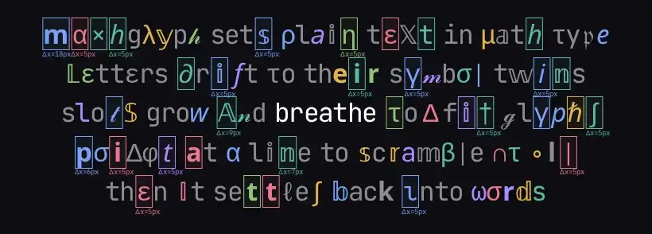
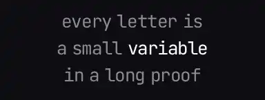
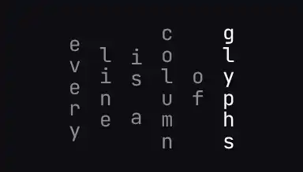
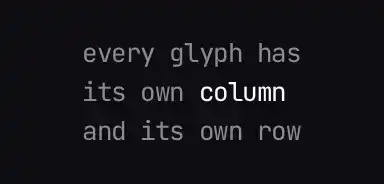
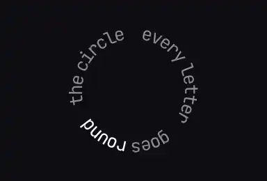
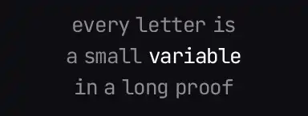

# mathglyph

A small text effect: monospace text where some letters turn into math glyphs (𝕋 𝒢 ∃ ⊗) and move under the pointer.

[Live demo](https://8xb300.github.io/mathglyph/) · [Demo source in `docs/`](docs/) · [llms.txt](https://8xb300.github.io/mathglyph/llms.txt) · [Contributing](CONTRIBUTING.md)



Give it a few lines of text. It shows them in monospace, with a math accent:

- At rest, some letters swap to math glyphs. Some glyphs get a colour from the palette, and some coloured glyphs get a box.
- The pointer scrambles the characters near it, then they settle. There is also a left-to-right decode intro (on by default) and a slow idle reshuffle (off by default).
- Words in `*stars*` are highlighted: white, and readable at rest.
- With `rest: 'plain'`, the text is plain at rest. The pointer wakes glyphs near it, and the slots widen. A few seconds after the pointer leaves, the text goes back to plain and the slots narrow. The preview above uses this mode.
- A [layout](#layouts) places the text: centred lines, columns, a grid or a ring. An [effect](#effects) sets what the pointer does: the glyphs breathe, ripple, burst into sparks, grow under a lens, fall like rain or break into dots. You can [stack effects](#stack-effects), and [write your own effect](#custom-effects) or [layout](#custom-layouts).

## How it's different

A typical text-scramble effect cycles random characters in a fixed grid. mathglyph differs in these ways:

- **Real math, not noise.** Letters swap to Unicode's math alphabets (𝔸 𝒢 𝔣 𝑛, with the older letters that fill the block's holes, like ℝ ℂ ℍ ℎ) and to notation from 21 fields, from logic and calculus to category theory.
- **Slots that fit the glyph.** Each slot widens to fit the glyph it shows, so wide symbols and short tokens (∫₀, ℏω, ⊗², &&) fit and the lines breathe. `expand: false` keeps a strict grid.
- **Smooth breathing.** Slot widths move on critically damped springs that run on the real frame time, and lines stay centred on them, so the motion never jumps or turns back when a glyph changes mid-motion, at 60, 120 or 144 Hz. A scrambling slot keeps its widest recent width for a moment instead of twitching with each glyph, glyphs crossfade, and boxes and labels move with their slots to the subpixel.
- **An anchor word.** `anchor` pins one word: it never changes, it stays at the middle of the element, and its line grows outward from it, so only the letters beyond a widening slot move.
- **Layouts and effects as modules.** Four layouts and six hover effects. Each one except the defaults is a small module, so a page loads only the ones it uses. An effect is a plain object with a few functions, so you can write your own.
- **Layouts of your own.** The four built-in layouts use a public interface: a `place()` function that sets where each glyph goes. Your own layout uses the same one, for example to set the lines on a sine wave.
- **Stacked effects.** `effect` takes a list, so a ripple and a lens can run together. Each effect has its own settings and a `strength`.
- **Hooks for your code.** `burst()`, `setPointer()`, `pause()` and `step()` let a script move the pointer and the clock, for example to record the effect frame by frame. The `'wake'` and `'settle'` events tell you when the frame loop starts and stops.
- **Readable at rest.** Look-alike swaps (∃ for E, ∪ for U, ∅ for O) and math versions of the same letter keep words legible.
- **Whole-word swaps.** Words with a symbol meaning turn into it: and → ∧, therefore → ∴, every → ∀. You can add your own words, in any language.
- **Bounding-box labels.** Boxes look like vision-model detections: a thin 1px rectangle with a tiny label that shows the slot's real width change, such as `Δx=30px`. Each box gets its own padding and a small offset, and one box can cover a few neighbouring glyphs of a word, so boxes vary in size and may overlap. `boxJitter: 0, boxSpan: 1` gives the v0.3.1 look: uniform boxes, one glyph each. `boxStyle: 'soft'` draws a rounded box instead.
- **Any script, any font.** Text is split into grapheme clusters, widths are measured per glyph, and you can load your own fonts.
- **No work when idle.** No timers or frames run while nothing moves, while the text is off screen, or while the tab is hidden.
- **No dependencies.** See [Sizes](#sizes) and [Performance](#performance).

## Use cases

- Hero headlines and landing pages.
- Docs and blog titles about math, CS or science.
- 404 pages and loading screens.
- Launch and announcement pages.
- Talk slides and portfolio headers.
- Sites for AI and research tools.

## Quick start

mathglyph is not on npm yet. Load it from jsDelivr, or copy `dist/` into your project.

```html
<h1 id="hero">Every proof starts with a good guess</h1>
<script type="module">
  import { mount } from 'https://cdn.jsdelivr.net/gh/8xb300/mathglyph@v0.6.0/dist/mathglyph.min.js';
  const lines = ['Every proof starts', 'with a *good* guess'];  // *stars* highlight a word
  mount(document.getElementById('hero'), { lines, palette: 'ice' });
</script>
```

With a plain script tag, the same exports are on the global `MathGlyph`:

```html
<script src="https://cdn.jsdelivr.net/gh/8xb300/mathglyph@v0.6.0/dist/mathglyph.iife.min.js"></script>
<script>
  MathGlyph.mount(document.getElementById('hero'), { lines: ['Every proof starts', 'with a *good* guess'] });
</script>
```

If you copy `dist/`, import `mathglyph.min.js` from wherever you put it. Types are in `dist/mathglyph.d.ts`.

### Configure in code

The sliders are only on the demo page. The library ships with no UI: you set options at mount and change them live from your own code.

```js
const fx = mount(document.getElementById('hero'), {
  lines: ['every *function* has a story', 'and every story has an end'],
  palette: 'ember',
  symbols: ['logic', 'calculus'],
});

fx.update({ palette: 'ice', substitute: 0.5 });  // change any option live
fx.replay();                                     // run the decode intro again
fx.reroll();                                     // pick new glyphs at rest
```

### Plain at rest

```js
mount(document.getElementById('hero'), {
  lines: ['every letter is a *variable*', 'and every word, a small *proof*'],
  rest: 'plain',  // plain text until the pointer touches it
  revert: 0,      // back to plain as soon as the pointer leaves (seconds to wait)
});
```

The intro decodes to plain text. On hover or touch, the characters near the pointer turn into glyphs and stay so while the pointer is over the text. When the pointer has been away for `revert` seconds (default 0, so at once), the glyphs settle back to their letters in a short wave from left to right, and the slots narrow. The pointer is away when it leaves the text or the window, when the window loses focus, or when the page is hidden. A change of options while the pointer is away also ends in plain text. The next hover picks new glyphs.

### Anchor

```js
mount(document.getElementById('hero'), {
  lines: [
    'every letter is a variable',
    'the symbols *breathe* around it',  // *stars* make the anchor white
    'then settle back into plain text',
  ],
  anchor: 'breathe',  // or true: the first *highlighted* word
});
```

Here "breathe" is the one white word. It stays still at the middle of the element while the glyphs around it come and go.

The anchor never swaps, never gets a box and never moves. Its middle sits at the middle of the element. In its line, the letters to its left grow leftward and the letters to its right grow rightward. The other lines centre on the same point. Put the anchor near the middle of its line: a line with much more text on one side reaches further out on that side.

### Without JavaScript

Put the plain text in the element, as in the first Quick start example. `mount` replaces it with the effect, and `destroy()` puts it back. Without JavaScript, or before the script loads, visitors and crawlers see the plain text.

## Layouts

`layout` places the slots. `'lines'` is built in. The others are [modules](#modules): import them and pass them to `register` first. Give settings with the name, as in `layout: { name: 'ring', gap: 2 }`. The anchor word works in every layout: it stays still, and the text moves around it. To write your own layout, see [Custom layouts](#custom-layouts).

| | Layout | Settings, with defaults |
|---|---|---|
|  | `'lines'`: centred lines. The default, built in. | none |
|  | `'columns'`: vertical text, made for Chinese, Japanese and Korean. Each line is a column, and the characters stack top to bottom, upright. A slot grows along its column as its glyph widens, so a column breathes up and down from its middle, or from its anchor word. Text that is mostly CJK reads right to left, as in traditional vertical writing, and its characters stack closer. A few short columns look best: 3 or 4 columns of 5 to 8 characters. See [Vertical CJK](#vertical-cjk). | `columnGap: 0.5`: the space between two columns, in em. A column is 1 em wide, the width of a CJK character, so `0` sets the columns side by side, as the characters on a sign. Try 0.15 for a dense block, 1 for open columns. Code for v0.5.0 that sets `spacing` (em from the middle of one column to the next) still works: `spacing` wins when set.<br>`columnOrder: 'auto'`: `'rtl'` puts the first line on the right, `'ltr'` on the left. `'auto'` is `'rtl'` when most of the characters are CJK, else `'ltr'`. |
|  | `'grid'`: the lines are rows, each centred, and the characters sit in aligned columns. A wider glyph pushes its column wider and its row taller, so its neighbours move aside and up or down. | none |
|  | `'ring'`: the text runs around one circle, clockwise from the top, the lines one after the other. The ring grows outward as glyphs widen, and the glyphs turn with the circle. The anchor word stays at the top, and the circle grows down, away from it. With `fit`, the font size is the largest, up to `maxSize`, at which the text goes around the circle once, with a little space between the letters. A short phrase of 16 to 28 characters gives a full, readable circle. A long text gives a large circle in a small font. | `gap: 1`: the space between two lines, in em. |

## Effects

`effect` sets what the pointer does. The `motion` option sets when it runs: `'hover'` runs it where the pointer is, `'always'` also runs it with a slow wandering point while the pointer is away, and `'still'` never runs it. With `prefers-reduced-motion: reduce`, no effect runs.

`'breathe'` is built in. The others are [modules](#modules): import them and pass them to `register` first. v0.5.0 removed `'wave'`: a page that still asks for it gets `'breathe'` and one console warning. Give settings with the name:

```js
import { mount, register } from 'https://cdn.jsdelivr.net/gh/8xb300/mathglyph@v0.6.0/dist/mathglyph.min.js';
import { ripple } from 'https://cdn.jsdelivr.net/gh/8xb300/mathglyph@v0.6.0/dist/effects/ripple.min.js';

register(ripple);
const fx = mount(element, { effect: 'ripple' });               // the default settings
fx.update({ effect: { name: 'ripple', speed: 1.5, gap: 3 } });  // settings you leave out keep their defaults
```

Distances are in em: 1 em is the font size. Each effect's `speed` is multiplied by the `speed` option.

| | Effect | Settings, with defaults |
|---|---|---|
|  | `'breathe'`: glyphs near the pointer scramble, and their slots widen. The default, built in. | none |
|  | `'ripple'`: rings run out from the pointer, and glyphs swap and pulse as a ring passes them. | `speed: 1`: how fast the rings grow.<br>`radius: 5`: how far a ring runs before it has faded out, in em.<br>`gap: 2.5`: the space between two rings, in em. A moving pointer starts a ring each time the last one is this wide.<br>`pulse: 0.4`: how much a glyph grows as a ring passes, as a share of its size (0.4: 40% larger). It rises a little too. |
|  | `'firework'`: glyphs near the pointer burst outward with a few coloured sparks, then spring back. | `speed: 1`: how fast glyphs fly out and spring back.<br>`radius: 1.7`: how near the pointer comes before a glyph bursts, in em.<br>`power: 0.8`: how far a glyph flies out, in em.<br>`spin: 0.5`: the most a glyph turns as it flies, in radians. About 2 in 5 glyphs turn.<br>`sparks: 2`: the sparks that fly from each glyph. |
|  | `'lens'`: a magnifier follows the pointer. Letters under it grow, the most at its centre, and the letters around them move aside. | `speed: 1`: how fast the lens follows the pointer, grows and shrinks.<br>`radius: 6`: how far the lens reaches, in em. Letters in its inner third grow; the rest only move aside.<br>`zoom: 1.8`: how large the letter at the centre grows, as a scale (1 is its normal size).<br>`swap: true`: the letters near the centre swap to math glyphs as the lens passes over them. |
|  | `'cascade'`: letters near the pointer drop from above into their slots, like rain. The columns start one after another, the nearest to the pointer first. The letters of a column fall together, scramble and fade in, then lock in place with a small bounce. | `speed: 1`: how fast the letters fall and lock in, and how often a column starts.<br>`radius: 3`: how near the pointer a letter must be to fall, in em.<br>`fall: 2.5`: how far above its slot a letter starts to fall, in em, at most 3. |
|  | `'shatter'`: letters near the pointer break into round dots that scatter a little, then fly back and come together again, often as a new glyph. | `speed: 1`: how fast the dots fly out and back.<br>`radius: 1.8`: how near the pointer a letter must be to break, in em.<br>`scatter: 0.5`: how far the dots fly out, in em, at most 0.6.<br>`dots: 12`: the most dots a letter breaks into. |

### Stack effects

Give `effect` a list, and the effects run together, in the order of the list:

```js
import { lens } from 'https://cdn.jsdelivr.net/gh/8xb300/mathglyph@v0.6.0/dist/effects/lens.min.js';

register(ripple, lens);
mount(element, { effect: ['ripple', { name: 'lens', strength: 0.5 }] });
```

Each effect keeps its own settings and state. Their offsets and rotations add, and their scales and opacities multiply. Any of them can swap a glyph.

`strength`, from 0 to 1 (default 1), scales what one effect does: at 0.5, the lens moves the letters aside and grows them half as much. The swaps of an effect with strength 0.5 count for half of the glyphs, the same half each time (the glyphs whose `seed` is below 0.5). One effect with a strength, such as `effect: { name: 'lens', strength: 0.5 }`, is a stack of one.

An effect without `frame()`, such as `'breathe'`, runs in a stack only in frames where the pointer moved, and only its swaps count, as when it runs alone. The stack runs in the same one frame loop as a single effect: each effect's `speed` is still multiplied by the `speed` option, and the loop stops when every effect is at rest.

[Custom effects](#custom-effects) stack too. Keep a glyph's state in `g.fx` and the mount's state in `f.state`, never in module variables: the engine gives each effect in a stack its own. In a stack, `paint()` gets the values of the whole stack in `out`. The engine eases the glyphs back to rest only when every effect's `frame()` returns false, so an effect that stops while another one still runs drops what it set at once.

## Custom effects

An effect is an object with a name and a few functions. The engine calls them in its one frame loop, with the real frame time. This one turns the glyphs near the pointer:

```js
// Glyphs near the pointer turn, up to half a turn, and swap near the centre.
const spin = {
  name: 'spin',
  defaults: { radius: 3 },  // em
  // Run while the pointer is on the text. When it leaves, the engine eases the glyphs back.
  frame: (f) => f.pointer !== null,
  glyph(g, out, f) {
    const d = Math.hypot(g.cx - f.pointer.x, g.cy - f.pointer.y) / (f.settings.radius * f.fs);
    if (d >= 1) return;  // 0 at the pointer, 1 at the edge
    out.rotate = (1 - d) ** 2 * Math.PI;
    out.swap = d < 0.3;
  },
};

mount(element, { effect: spin });
```

Pass the object as `effect`, or pass it to `register` and use its name. The engine does not call an effect with `prefers-reduced-motion: reduce` or `motion: 'still'`. The types are in `dist/mathglyph.d.ts`.

An effect has these fields. Only `name` and `glyph` are required.

| Field | What it does |
|---|---|
| `name` | The name for `effect` and `register`. |
| `defaults` | Settings and their default values. The user's `effect: { name, ...settings }` goes over them. |
| `frame(f)` | Called once per frame, before `glyph()`. Return true while the effect still moves something, and the loop keeps running. Return false, and the loop can sleep: the engine eases every glyph back to rest in 0.2 s (divided by the `speed` option). If `frame()` returns true again before that, the new outputs replace the eased ones at once. Without `frame()`, `glyph()` runs only in frames where the pointer moved, and swaps are its only output, as in `'breathe'`. |
| `glyph(g, out, f)` | Called for each glyph in frames where `frame()` returned true. Set the fields of `out`. |
| `paint(ctx, g, out, f)` | Draws extras for one glyph, such as sparks or dots, after the engine draws the glyph. It runs only if `glyph()` set `out.paint`. `ctx` is in CSS px, and the engine wraps each call in `save()` and `restore()`. `out` holds the glyph's values from this frame. |
| `reach` | How far a glyph or its paint can go from its slot, in line heights. The engine redraws that much around it, and in a layout with `bands`, such as `'lines'`, it clips what goes further. Default 1. |

`g` is one glyph. The engine owns every field except `fx`: read them, but do not write them. The engine never calls `glyph()` for the anchor word, but its glyphs are in `f.glyphs`.

| Field | What it holds |
|---|---|
| `i` | Index in the whole text, from 0. |
| `line`, `col` | The line of the source text, and the position in that line, from 0. |
| `cx`, `cy` | The centre of the slot at rest, in CSS px. The layout sets it. |
| `w` | The size of the slot along the text, in CSS px. It moves on a spring as glyphs swap. |
| `r` | The angle of the slot, in radians. The layout sets it: 0 in `'lines'`, `'columns'` and `'grid'`. |
| `ch`, `g` | The source character, and the glyph shown now. |
| `seed` | A random number in [0, 1), fixed for this glyph. |
| `anchor` | true for the glyphs of the anchor word. |
| `fx` | Free for the effect: state for this glyph. It starts undefined. The engine clears it when the effect or the text changes. |

`out` is what the effect sets for one glyph in one frame. Before each call to `glyph()`, the engine resets it to rest.

| Field | At rest | What it does |
|---|---|---|
| `x`, `y` | 0 | Offset from the slot centre, in CSS px. |
| `scale` | 1 | Size. 1 is normal. |
| `rotate` | 0 | Rotation in radians, added to the slot angle. |
| `alpha` | 1 | Opacity, from 0 to 1. It applies to the glyph, its box and its label. |
| `swap` | false | true: the glyph swaps now. It scrambles for a moment, then settles, as under the pointer. With `rest: 'plain'`, it counts only while the pointer is on the text, and for a moment after [`burst()`](#drive-it-from-your-code). |
| `paint` | false | true: the engine calls `paint()` for this glyph in this frame. |

`f` is what the effect gets in each frame.

| Field | What it holds |
|---|---|
| `now` | The requestAnimationFrame time, in ms. |
| `dt` | The real time since the last frame, in ms, at most 100. |
| `pointer` | `{ x, y }` in CSS px from the top left of the canvas, or null when the pointer is not on the text. With `motion: 'always'`, a slow wandering point stands in while the pointer is away. |
| `moved` | true in frames where the pointer moved. The wandering point moves in every frame. |
| `radius` | The hover radius in CSS px: the font size times the `hoverRadius` option. |
| `fs`, `lineH` | The font size (1 em) and the line height, in CSS px. |
| `width`, `height` | The canvas size, in CSS px. |
| `speed` | The `speed` option. Multiply your own speed setting by it. |
| `palette` | The palette colours. |
| `font` | The canvas font, for example `"24px ui-monospace, ..."`. |
| `settings` | The effect's `defaults`, with the user's settings over them. |
| `state` | Free for the effect: state for this mount. It starts as `{}`. The engine clears it when the effect changes. |
| `glyphs` | Every glyph, in text order, so `f.glyphs[g.i]` is `g`. |

## Custom layouts

A layout is an object with a name and a `place()` function. The four built-in layouts use the same interface, `'lines'` too. This one centres the lines on a sine wave and turns each glyph with the slope. [`docs/examples/sine.js`](docs/examples/sine.js) holds it, and the demo imports it from there:

```js
// sine: a custom layout, written with the same public interface as the built-in ones. The lines
// are centred, on a baseline that runs as a sine wave, and each glyph turns with the wave's slope.
// amplitude: the height of the wave above and below the line's middle, in em.
// wavelength: the length of one wave, in em.

export var sine = {
  name: 'sine',
  defaults: { amplitude: 0.4, wavelength: 7 },
  // The widest line fits the width, as in 'lines', with room for the wave above and below.
  size: function (m) {
    var most = 1;
    // An anchored line is as wide as twice its longer side, since the anchor stays in the middle.
    m.lines.forEach(function (L) { most = Math.max(most, L.a1 ? 2 * Math.max(L.mid, L.natural - L.mid) : L.natural); });
    var fs = m.fit ? Math.max(8, Math.min(m.maxSize, m.width / (most * 1.2))) : m.fs;
    return { fs: fs, height: Math.ceil((m.lines.length * m.lineEm + 2 * m.settings.amplitude) * fs) };
  },
  // From the slot sizes w: each glyph's centre (cx, cy) and angle (r). The anchor word's middle
  // stays at the middle of the width, so it never moves.
  place: function (m) {
    var a = m.settings.amplitude * m.fs, k = 2 * Math.PI / (m.settings.wavelength * m.fs);
    m.lines.forEach(function (L, i) {
      var cs = L.cells, x = 0, left, mid = a + (i + 0.5) * m.lineH;
      cs.forEach(function (c) { c.x = x; x += c.w; });
      left = L.a1 ? (m.width - cs[L.a0].x - cs[L.a1 - 1].x - cs[L.a1 - 1].w) / 2 : (m.width - x) / 2;
      cs.forEach(function (c) {
        var t = left + c.x + c.w / 2;
        c.cx = t;
        c.cy = mid + a * Math.sin(k * t);
        c.r = Math.atan(a * k * Math.cos(k * t));
      });
    });
  }
};
```

Pass the object as `layout` to use its defaults, or pass it to `register` and use its name with settings:

```js
import { sine } from './sine.js';  // your copy of docs/examples/sine.js

register(sine);
mount(element, { layout: { name: 'sine', amplitude: 0.6, wavelength: 9 } });  // in em
```

A layout has these fields. Only `name` and `place` are required.

| Field | What it does |
|---|---|
| `name` | The name for `layout` and `register`. |
| `defaults` | Settings and their default values. The user's `layout: { name, ...settings }` goes over them. |
| `size(m)` | Returns `{ fs, height, pad }`: the font size and the canvas height, in CSS px, and `pad` (optional), the em that every slot gets along the text on top of its glyph's width. The engine calls it on start, resize, font load and `update`, never in the frame loop, so it may read `m.viewH`. Without `size()`, the engine sizes the text as `'lines'` does: with `fit`, the widest line fits the width, and each line is one line height tall. |
| `place(m)` | Sets `cx`, `cy` and `r` of every glyph from the slot sizes `w`. The engine calls it after `size()`, and in each frame where something changed. Return true while you move something on springs of your own, and the engine calls it in the next frame too. Use only what `m` holds: do not read the page. Keep the anchor word still. |
| `bands` | true: line i is the strip of the canvas from i to i + 1 line heights, and a slot change moves only its own line. The engine then redraws only the changed strips. Otherwise it redraws everything. |
| `vertical` | true: the slots stack down the canvas, and labels read down beside their box instead of under it. |

`m` is what the layout gets. Sizes are in CSS px, unless the field says em.

| Field | What it holds |
|---|---|
| `width`, `height` | The element's content width, and the canvas height that `size()` returned. |
| `viewH` | The viewport height. Read it only in `size()`. |
| `fs` | The font size (1 em). In `size()`, it is the element's CSS font size with `fit: false`, and 0 with `fit`. |
| `fit`, `maxSize`, `expand` | The options of the same name. |
| `speed` | The `speed` option, at least 0.25. |
| `lineEm` | The line height, in em. |
| `lineH`, `boxH` | The line height and the box height, from the font size that `size()` returned. |
| `lines` | One object per line of the text. `cells`: its glyphs. `a0`, `a1`: its anchor word is the glyphs from `a0` up to `a1`, not included; `a1` is 0 if the line has no anchor. `natural`: the line's plain size along the text, in em. `mid`: the middle of its anchor word, in em from the start of the line. A layout can keep its own data for a line on this object, as `'lines'` keeps `top` and `left`. |
| `anchor` | The anchor word, `{ line, from, to }`, or null. Its glyphs go from `from` up to `to`, not included. |
| `settings` | The layout's `defaults`, with the user's settings over them. |
| `state` | Free for the layout: state for this mount. It starts as `{}`. The engine clears it after each `size()`, before it calls `place()`. |
| `dirty` | In `place()`: true for each line whose slots changed since the last call. A layout can skip the other lines, as `'lines'` does. |
| `dt` | The real time since the last frame, in ms. 0 outside the frame loop. |

Each glyph in `cells` has the fields of `g` in [Custom effects](#custom-effects), and three more: `pw`, the size of the slot along the text at rest, in em; `peak`, the size that `w` moves to, in CSS px; and `x`, free for the layout, for example for the slot's offset along its line. The built-in layouts in [`src/layouts/`](src/layouts/) are more examples.

## Mixed scripts

`scripts` mixes in letters from Greek and Cyrillic. Each swap of a Latin letter picks a script by weight. `'latin'` gives a math glyph or a symbol, as without `scripts`. `'greek'` and `'cyrillic'` give a letter of that script that looks like the Latin one: e → ε or э, n → η or п, R → Я.

```js
mount(element, { scripts: ['latin', 'greek', 'cyrillic'] });  // each script as often as the others
mount(element, { scripts: { latin: 2, greek: 1 } });           // Latin twice as often as Greek
```

The default, `null`, is Latin only. A letter with no look-alike in the picked script swaps as in Latin. The tables leave out letters that look the same as the Latin one, such as Greek Α and Cyrillic А, since a swap to them would show nothing. `scripts` only changes how Latin letters swap. For Greek and Cyrillic text, see [Languages](#languages).

## Modules

The core, `mathglyph.min.js`, has the `'lines'` layout and the `'breathe'` effect. Each other layout and effect is a module of its own, which exports one object with the module's name. Import the ones you use, and pass them to `register` before `mount`:

```js
import { mount, register } from 'https://cdn.jsdelivr.net/gh/8xb300/mathglyph@v0.6.0/dist/mathglyph.min.js';
import { ring } from 'https://cdn.jsdelivr.net/gh/8xb300/mathglyph@v0.6.0/dist/layouts/ring.min.js';
import { firework } from 'https://cdn.jsdelivr.net/gh/8xb300/mathglyph@v0.6.0/dist/effects/firework.min.js';

register(ring, firework);
mount(document.getElementById('hero'), { layout: 'ring', effect: 'firework' });
```

With a plain script tag, load the all-in-one build. It has every layout and effect registered, and the Greek, Cyrillic and CJK tables:

```html
<script src="https://cdn.jsdelivr.net/gh/8xb300/mathglyph@v0.6.0/dist/mathglyph.all.iife.min.js"></script>
<script>
  MathGlyph.mount(document.getElementById('hero'), { layout: 'ring', effect: 'firework' });
</script>
```

### Sizes

Every file is in `dist/`, and the links go to jsDelivr. `dist/mathglyph.js` is the core without minification, for bundlers. The types are in `dist/mathglyph.d.ts`, and each module has its own beside it, such as `dist/effects/ripple.d.ts`.

<!-- numbers: sizes -->
| File | What it holds | Minified | Gzipped |
|---|---|--:|--:|
| [`mathglyph.min.js`](https://cdn.jsdelivr.net/gh/8xb300/mathglyph@v0.6.0/dist/mathglyph.min.js) | The core, as an ES module: `mount`, `register`, the tables, `'lines'` and `'breathe'`. | 30,814 B | 14,145 B |
| [`mathglyph.iife.min.js`](https://cdn.jsdelivr.net/gh/8xb300/mathglyph@v0.6.0/dist/mathglyph.iife.min.js) | The core for a script tag, on the global `MathGlyph`, with the Greek, Cyrillic and CJK tables. | 32,999 B | 15,537 B |
| [`mathglyph.all.iife.min.js`](https://cdn.jsdelivr.net/gh/8xb300/mathglyph@v0.6.0/dist/mathglyph.all.iife.min.js) | The script-tag build with every layout and effect registered. | 43,282 B | 19,970 B |
| [`languages.min.js`](https://cdn.jsdelivr.net/gh/8xb300/mathglyph@v0.6.0/dist/languages.min.js) | The Greek, Cyrillic and CJK look-alike tables. | 1,762 B | 1,086 B |
| [`layouts/columns.min.js`](https://cdn.jsdelivr.net/gh/8xb300/mathglyph@v0.6.0/dist/layouts/columns.min.js) | The `'columns'` layout. | 1,305 B | 700 B |
| [`layouts/grid.min.js`](https://cdn.jsdelivr.net/gh/8xb300/mathglyph@v0.6.0/dist/layouts/grid.min.js) | The `'grid'` layout. | 1,920 B | 999 B |
| [`layouts/ring.min.js`](https://cdn.jsdelivr.net/gh/8xb300/mathglyph@v0.6.0/dist/layouts/ring.min.js) | The `'ring'` layout. | 1,027 B | 544 B |
| [`effects/ripple.min.js`](https://cdn.jsdelivr.net/gh/8xb300/mathglyph@v0.6.0/dist/effects/ripple.min.js) | The `'ripple'` effect. | 1,116 B | 713 B |
| [`effects/firework.min.js`](https://cdn.jsdelivr.net/gh/8xb300/mathglyph@v0.6.0/dist/effects/firework.min.js) | The `'firework'` effect. | 1,378 B | 826 B |
| [`effects/lens.min.js`](https://cdn.jsdelivr.net/gh/8xb300/mathglyph@v0.6.0/dist/effects/lens.min.js) | The `'lens'` effect. | 1,040 B | 648 B |
| [`effects/cascade.min.js`](https://cdn.jsdelivr.net/gh/8xb300/mathglyph@v0.6.0/dist/effects/cascade.min.js) | The `'cascade'` effect. | 995 B | 611 B |
| [`effects/shatter.min.js`](https://cdn.jsdelivr.net/gh/8xb300/mathglyph@v0.6.0/dist/effects/shatter.min.js) | The `'shatter'` effect. | 1,951 B | 1,169 B |

### Package exports

mathglyph is not on npm yet. To install it from GitHub, run `npm install github:8xb300/mathglyph#v0.6.0`. The package exports the core, the languages, and every module by name, with their types:

```js
import { mount, register } from 'mathglyph';
import { greek, cyrillic, cjk } from 'mathglyph/languages';
import { ring } from 'mathglyph/layouts/ring';
import { firework } from 'mathglyph/effects/firework';
```

## Options

Every option has a default. Pass any of them to `mount`, or change them later with `update`. Shares and rates are numbers from 0 to 1.

| Option | Default | What it does |
|---|---|---|
| `lines` | `['plain text, now with', 'a *math* accent']` | One string per row. Wrap words in `*stars*` to highlight them. |
| `layout` | `'lines'` | How the slots are placed: `'lines'`, `'columns'`, `'grid'` or `'ring'`, a name with settings (`{ name, ...settings }`), or your own layout object (`Layout` in `dist/mathglyph.d.ts`). See [Layouts](#layouts) and [Custom layouts](#custom-layouts). |
| `effect` | `'breathe'` | What the pointer does: `'breathe'`, `'ripple'`, `'firework'`, `'lens'`, `'cascade'` or `'shatter'`, a name with settings (`{ name, ...settings }`), your own effect object, or a list of these that run together. The settings can include a `strength`, from 0 to 1. See [Effects](#effects), [Stack effects](#stack-effects) and [Custom effects](#custom-effects). |
| `scripts` | `null` | Scripts that swaps take look-alike letters from: `['latin', 'greek', 'cyrillic']`, or names with weights, like `{ latin: 2, greek: 1 }`. `null` is Latin only. See [Mixed scripts](#mixed-scripts). |
| `palette` | `'pastel'` | `'pastel'`, `'ember'`, `'ice'`, `'mono'`, `'shimmer'`, or an array of CSS colours. `'shimmer'` is the colours of the glyphs in the background of 8xb300.org. Its navy is `#6475d8`, lightened from the site's `#131836` so it reads on dark backgrounds. |
| `substitute` | `0.35` | Share of letters swapped at rest. |
| `color` | `0.55` | How often glyphs get a palette colour. |
| `box` | `0.22` | How often coloured glyphs get a box. |
| `boxStyle` | `'detect'` | `'detect'`: a thin 1px rectangle with a label. `'soft'`: a rounded box with a faint fill. |
| `boxJitter` | `0.5` | How much boxes vary, from 0 to 1. Each box gets its own random padding and a small offset, so sizes and edges vary like vision-model detections. `0` gives uniform boxes. |
| `boxSpan` | `3` | The most neighbouring glyphs one box covers, within a word. Boxes may overlap. `1` gives one glyph per box. |
| `labels` | `0.6` | Share of boxes that show a label (`'detect'` only). |
| `labelFormat` | `null` | A function `(cell) => string` for your own label text. See [Labels](#labels). |
| `symbols` | `'all'` | `'all'`, or an array of group names. See [Symbol groups](#symbol-groups). |
| `sets` | `null` | Extra symbol groups, `{ name: { symbols, tokens? } }`. You can name them in `symbols`. |
| `tokens` | `true` | Also swap in short notation like ∫₀, ℏω, ⊗², &&. Only with `expand`. |
| `symbolMix` | `0.15` | Share of swaps that use the symbol groups instead of a math-alphabet or Greek version of the same letter. |
| `legible` | `0.6` | How often a swapped letter uses a symbol that looks like it: ∃ for E, ∪ for U, ∅ for O. |
| `lookalikes` | `null` | Extra look-alikes, `{ char: 'glyphs' }`, merged over the built-in Latin table. Also how you plug in the Greek, Cyrillic and CJK tables. See [Languages](#languages). |
| `words` | `0.7` | How often words with a symbol meaning swap whole. Needs `expand`. |
| `wordMap` | `null` | Extra word → symbol pairs, merged over the English map. |
| `motion` | `'hover'` | When the effect runs. `'hover'`: where the pointer is. `'always'`: also with a slow wandering point while the pointer is away, and with a slow reshuffle. `'still'`: no animation. |
| `rest` | `'glyphs'` | `'glyphs'`: some letters show glyphs at rest. `'plain'`: plain text at rest, glyphs only where the pointer touched. See [Plain at rest](#plain-at-rest). |
| `revert` | `0` | With `rest: 'plain'`: seconds after the pointer leaves before the text goes back to plain. |
| `anchor` | `null` | A word that never changes and never moves: a string pins its first match (a whole word if there is one), `true` the first *highlighted* word. See [Anchor](#anchor). |
| `tracking` | `-0.04` | Extra space between letters, in em. Negative values set letters closer. |
| `wordSpacing` | `0.3` | The width of a space, in em. A monospace space is about `0.6`. |
| `intro` | `true` | Left-to-right decode on first show. |
| `speed` | `1` | How fast the scramble flickers and settles, from `0.25` to `2`. It also sets how fast slots and lines glide. |
| `hoverRadius` | `2.6` | How far the pointer reaches, in character heights. |
| `expand` | `true` | Each slot widens to fit its glyph. `false` keeps a strict grid. |
| `base` | `'#8d8b93'` | Colour of plain text. |
| `highlight` | `'#ffffff'` | Colour of highlighted words. |
| `font` | system monospace stack | CSS `font-family` stack. See [Fonts](#fonts). |
| `fonts` | `[]` | Fonts to load. See [Fonts](#fonts). |
| `fit` | `true` | Scale the font so the text fits the container width. In `'ring'`, the circle fits it. |
| `maxSize` | `44` | Largest font size in px for `fit`. |

### Labels

With `boxStyle: 'detect'`, some boxes get a label under their bottom edge. `Δx=30px` means the slot is 30px wider than a plain monospace slot. When a box covers several glyphs, `Δx` is for the first one. Set `labels: 0` to hide them all, or write your own text:

```js
mount(element, {
  labelFormat: (cell) => `${cell.char}→${cell.glyph}`,  // "E→∃"
});
```

`cell` has:

- `glyph`: the glyph the slot shows now
- `char`: the original character of the slot
- `dx`: width change against a plain monospace slot, in CSS px, rounded
- `width`: width of the slot now, in CSS px
- `color`, `line` and `column`

### Symbol groups

`symbols: 'all'` uses every group. To narrow it down, list group names, like `symbols: ['logic', 'calculus']`.

| Name | Label | For example |
|---|---|---|
| `general` | General | ÷ ≠ ≤ ≈ ± √ × |
| `calculus` | Calculus | ∑ ∏ ∫ ∮ ∂ ∇ ∞ |
| `logic` | Logic & sets | ∀ ∃ ¬ ∧ ⊢ ⊨ ∈ ∪ ℵ |
| `linalg` | Linear algebra | ⊗ ⊕ ⊙ ⊥ ⟨ ⟩ † ‖ |
| `numbers` | Number theory | ≡ ∣ ⌊ ⌋ ℤ ℚ ℕ ℝ |
| `geometry` | Geometry | △ □ ○ ∠ ∥ ≅ ° π |
| `statistics` | Statistics | ∝ 𝔼 ℙ 𝕍 μ σ χ |
| `physics` | Physics | ℏ ∝ Å ∂ ∇ ∮ ℓ |
| `engineering` | Engineering | ∠ ∥ Ω ⌀ ± ° |
| `chemistry` | Chemistry | ⇌ ⟶ ↑ ↓ ‡ Δ |
| `cs` | CS | λ ↦ ≡ ∘ ← ⊕ ⊑ |
| `greek` | Greek | α β γ δ θ λ π ψ Ω |
| `bioastro` | Bio & astro | ♀ ♂ ☉ ⊕ |
| `economics` | Economics | ≻ ≺ ≿ 𝔼 Δ Γ |
| `philosophy` | Philosophy | □ ◇ ∴ ∵ ⊢ ⊩ ⊸ ⅋ |
| `proofs` | Proofs | ∎ ∴ ∵ ≔ ≝ ≜ ⋯ |
| `linguistics` | Linguistics | ə ʃ ʒ ŋ ð θ ʔ ⟦ ⟧ |
| `law` | Law & texts | § ¶ † ‡ |
| `finance` | Finance | € £ ¥ ₹ ₿ ‰ |
| `category` | Category theory | ↪ ↠ ⇉ ⊣ ≅ ∘ ⟹ |
| `functional` | Functional prog. | λ ∘ ⊥ → ⇒ ∀ ∷ |

Add your own groups with `sets`. `'all'` includes them, and you can name them in `symbols` like any other group. A group's `symbols` can be a string, which is split into characters. Its `tokens` are optional and only show when `expand` is on.

```js
mount(element, {
  sets: { music: { symbols: '♩♪♫♭♮♯', tokens: ['♭♭', '♯♯'] } },
  symbols: ['music', 'logic'],
});
```

## API

`mount(element, options)` starts the effect and returns an object with these methods:

```js
const glyphs = mount(element, options);

glyphs.update({ palette: 'ember' });  // change any option live; pass only what changes
glyphs.replay();                      // run the intro again
glyphs.reroll();                      // pick new glyphs at rest
glyphs.destroy();                     // stop everything and restore the element
```

It also has `burst`, `setPointer`, `clearPointer`, `pause`, `resume`, `step`, `on` and `off`, for your own code. See [Drive it from your code](#drive-it-from-your-code).

`register(...modules)` adds layouts and effects, so that `layout` and `effect` can name them. Call it before `mount`. See [Modules](#modules).

The module also exports its built-in tables:

| Export | What it holds |
|---|---|
| `palettes` | The built-in palettes by name, each an array of CSS colours. |
| `sets` | The 21 symbol groups: `{ name: { label, symbols, tokens } }`. |
| `words` | The English word → symbol map. |
| `lookalike` | The built-in Latin look-alike table: character → glyphs. |
| `defaults` | The default options. |

Use them to build on the defaults:

```js
import { mount, sets, palettes } from 'https://cdn.jsdelivr.net/gh/8xb300/mathglyph@v0.6.0/dist/mathglyph.min.js';

mount(element, {
  symbols: Object.keys(sets).filter((name) => name !== 'greek'),  // every group but Greek
  palette: [...palettes.ice, '#ffffff'],                           // ice, plus white
});
```

### Drive it from your code

The object that `mount` returns can also move the pointer and the clock, so a script, a scroll position or a recorder can drive the effect. `x` and `y` are CSS px from the top left of the canvas that mathglyph draws in. The canvas is the element's first child.

```js
const fx = mount(element, { rest: 'plain', intro: false });
const canvas = element.firstElementChild;

// Record a burst in the middle of the text, frame by frame, until the text is at rest again.
const frames = [];
let done = false;
const off = fx.on('settle', () => { done = true; });
fx.pause();
fx.burst(canvas.clientWidth / 2, canvas.clientHeight / 2);
while (!done && frames.length < 600) {  // at most 10 s
  fx.step(1000 / 60);                   // one frame of 1/60 s
  frames.push(canvas.toDataURL());
}
off();
fx.resume();
```

| Method | What it does |
|---|---|
| `burst(x, y)` | The pointer touches (x, y) for one frame and leaves. For 400 ms after (divided by the `speed` option), swaps still count as if the pointer were on the text, so what the effect started can play out. With `rest: 'plain'`, the text then goes back to plain, as after a real pointer leaves. |
| `setPointer(x, y)` | Moves the pointer to (x, y), and it stays there, as a real pointer that stops. Real pointer events still apply: a real pointer on the text moves it, and it leaves when a real pointer leaves the text or the window, when the window loses focus, or when the page is hidden. |
| `clearPointer()` | The pointer leaves the text, as when a real pointer leaves it. |
| `pause()` | Stops the frame loop. Nothing moves until `resume()`, except by `step()`. |
| `resume()` | Ends the pause. The loop runs again while something moves. |
| `step(ms)` | Only while paused: moves time on by `ms`, in equal frames of at most 1/60 s. When it returns, the canvas shows the last frame. The `revert` delay is a real timer, so `step()` does not move it on. |
| `on(event, fn)` | Calls `fn` at each `event`, `'wake'` or `'settle'`. Returns a function that removes the listener. |
| `off(event, fn)` | Removes a listener that `on()` added. |

`'wake'` comes when the frame loop starts to run frame after frame. `'settle'` comes when it stops because nothing moves. The events also come in the frames that `step()` runs. When the loop stops because the text is off screen, the tab is hidden or you call `pause()`, no event comes. With `motion: 'always'`, the loop runs on while the text is on screen, and `'settle'` does not come.

With `prefers-reduced-motion: reduce` or `motion: 'still'`, `burst()` and `setPointer()` do nothing. The hooks add no timer. A call can start the frame loop, and the loop stops again when nothing moves, so nothing runs while idle.

## Fonts

The default `font` is a system monospace stack with math fallbacks. Nothing loads from a font CDN.

To use other fonts, list them in `fonts`. Each entry is one of:

- `'IBM Plex Mono'`: a family your page already provides, for example with your own `@font-face` rule.
- `{ family: 'IBM Plex Mono', url: '/fonts/plex-mono.woff2' }`: a font file, loaded with the FontFace API.
- `{ family: 'IBM Plex Mono', src: 'url(/fonts/plex-mono-bold.woff2)', weight: '700' }`: a CSS `src` value plus any FontFace descriptors, also loaded with the FontFace API.

Each font in `fonts` goes at the front of the `font` stack, unless `font` already names it. Then it stays where you put it.

Widths are measured per glyph with the real font stack, and measured again when a font loads. So slots and labels stay right while fonts arrive.

### Math fallback font (recommended on Linux)

Linux systems often lack math glyphs, and a missing glyph shows as an empty box. This repo ships an optional fallback: [`fonts/noto-sans-math-subset.woff2`](fonts/noto-sans-math-subset.woff2). It is Noto Sans Math, subset to the glyphs the effect uses, under the SIL OFL 1.1 (licence in [`fonts/OFL.txt`](fonts/OFL.txt)). Host it with your site and load it:

```js
mount(element, {
  fonts: [{ family: 'Noto Sans Math', url: '/your/path/noto-sans-math-subset.woff2' }],
});
```

The default stack already names 'Noto Sans Math', so it slots in after the monospace fonts.

### Hong Kong type

The demo shows Traditional Chinese in three styles seen all over Hong Kong. Pick one with the chips 路, 黑 and 宋 on the columns card, or in the font picker. Each is a self-hosted subset of 6 to 9 KB (see [docs/fonts](docs/fonts/README.md)):

- **Road-sign style (路):** [Dela Gothic One](https://github.com/syakuzen/DelaGothic) by artakana, SIL OFL 1.1. It stands in for Prison Gothic (監獄體), the lettering that inmates of Stanley Prison cut by hand for road signs from the 1970s to 1997. Its digital revival by the Road Research Society (道路研究社) is a commercial font, and no openly licensed version exists, so the demo does not use that name.
- **Heiti (黑體, 黑):** [Chiron Hei HK](https://github.com/chiron-fonts/chiron-hei-hk) at weight 900 by the Chiron Hei HK Project Authors, from Adobe's Source Han Sans, SIL OFL 1.1. A sans with even strokes, in Hong Kong character forms.
- **Songti (宋體, 宋):** [Noto Serif HK](https://github.com/notofonts/noto-cjk) at weight 900 by Adobe, for Google's Noto, SIL OFL 1.1. The Ming style: thin horizontals, thick verticals and small triangular serifs, as on MTR station signs.

## Languages

Lines are split into grapheme clusters with `Intl.Segmenter`, so any script works, and so do emoji. Widths are measured, so wide characters (CJK, full-width forms) get wide slots.

The built-in look-alike table covers Latin. Greek, Cyrillic and CJK tables ship as a separate module, `dist/languages.min.js` (about 1 KB gzipped), so pages that don't need them don't load them. Plug them in with `lookalikes`:

```js
import { mount } from 'https://cdn.jsdelivr.net/gh/8xb300/mathglyph@v0.6.0/dist/mathglyph.min.js';
import { greek, cyrillic } from 'https://cdn.jsdelivr.net/gh/8xb300/mathglyph@v0.6.0/dist/languages.min.js';

mount(element, {
  lines: ['каждый знак — *переменная*'],
  lookalikes: { ...greek, ...cyrillic },
});
```

The script-tag builds already include them, as `MathGlyph.greek`, `MathGlyph.cyrillic` and `MathGlyph.cjk`.

These tables say what Greek, Cyrillic and CJK characters swap to. To mix Greek and Cyrillic letters into Latin text, see [Mixed scripts](#mixed-scripts).

Greek letters also get math-alphabet Greek (𝛂 𝜷 𝝅), with or without the table. Accented letters (é, ά, й) swap like their base letter. Letters from other scripts swap to symbols from the chosen groups.

### Vertical CJK

Chinese, Japanese and Korean are sometimes written in vertical columns, and the `'columns'` layout is made for them. Keep the text short, give each column a few characters, and let `fit` choose a large font:

```js
import { mount, register } from 'https://cdn.jsdelivr.net/gh/8xb300/mathglyph@v0.6.0/dist/mathglyph.min.js';
import { columns } from 'https://cdn.jsdelivr.net/gh/8xb300/mathglyph@v0.6.0/dist/layouts/columns.min.js';
import { cjk } from 'https://cdn.jsdelivr.net/gh/8xb300/mathglyph@v0.6.0/dist/languages.min.js';

register(columns);
mount(element, {
  layout: { name: 'columns', columnGap: 1 },
  lines: ['一字一变量', '一句一证明', '符号*呼吸*着', '又归于平淡'],
  anchor: '呼吸',
  lookalikes: cjk,
});
```

The first line is the rightmost column. The characters stay upright. A CJK slot keeps its full width when it swaps to a narrow symbol, so the columns do not shrink. The `cjk` table holds characters made of straight strokes and boxes: 一 → −, 二 → =, 三 → ≡, 十 → +, 口 → □, 田 → ⊞, 〇 → ∘ and a few more. A Hangul syllable swaps like its first consonant, so 아 and 오 can show ∘, and 마 can show □. Other characters swap to symbols. Put the anchor near the middle of its column: the column grows out from it. Set `lang` on the element (`zh-Hans`, `ja` or `ko`), so the browser picks the right font for Han characters.

For the look of a sign, set the columns close together and use a heavy font. The demo uses `columnGap: 0.15` and Noto Serif HK, JP and KR at weight 900 (SIL OFL 1.1), whose bold Ming strokes are close to the characters on Hong Kong MTR station signs. For Chinese it also offers two other [Hong Kong styles](#hong-kong-type). A CJK font is large, so the demo serves a subset of each with only the characters of its text, about 5 KB each (see [docs/fonts](docs/fonts/README.md)), and passes it as `fonts: [{ family, url }]`.

You can add your own tables:

- `lookalikes` adds look-alike glyphs. For example, `{ 'ß': 'β', 'ø': '∅⌀' }`.
- `wordMap` adds whole-word swaps. Word matching uses Unicode letters, so it works for any script that puts spaces between words.
- `sets` adds symbol groups (see [Symbol groups](#symbol-groups)).

In Spanish:

```js
mount(element, {
  lines: ['para todo ε existe un δ', 'y la *prueba* termina'],
  wordMap: { y: '∧', o: '∨', todo: '∀', existe: '∃' },
});
```

For CJK text with your own fonts, name both fonts in `font`, so the monospace font stays first for Latin letters and the CJK font only fills in what it lacks:

```js
mount(element, {
  lines: ['すべての *関数* には物語がある'],
  font: "'JetBrains Mono', 'Noto Sans JP', monospace",
  fonts: [
    { family: 'JetBrains Mono', url: '/fonts/jetbrains-mono.woff2' },
    { family: 'Noto Sans JP', url: '/fonts/noto-sans-jp.woff2' },
  ],
});
```

What does not work:

- Right-to-left scripts (Arabic, Hebrew) render left to right.
- Cursive scripts (Arabic, Syriac, Mongolian) lose their joined letter forms, because every character sits in its own slot.
- Languages written without spaces (Chinese, Japanese, Thai) get no whole-word swaps.

## Performance

- **No work at rest.** When nothing animates, no timers run. The effect also pauses when it is off screen (IntersectionObserver) and when the tab is hidden.
- **No layout reads in the animation loop.** Glyph widths and slot geometry are cached, and updated only on resize and when a font loads.
- **One `requestAnimationFrame` loop** drives the animation. It stops as soon as the last glyph settles.
- **One canvas, and only changed lines are redrawn.** Screen readers get a visually hidden copy of the text (see [Accessibility](#accessibility)).

### Numbers

Hovering over 2,000 characters (25 lines of 80) for 5 seconds, with a synthetic pointer that crosses every line. Median of 3 runs on Linux x86_64, headless Chromium 156, software rendering. `bench/run.mjs` measures it.

<!-- numbers: bench -->
| | First version | DOM renderer | v0.3.0 | v0.4.0 | v0.6.0 |
|---|---:|---:|---:|---:|---:|
| Main-thread time per frame while hovering | 8.1 ms | 5.7 ms | 3.0 ms | 3.0 ms | **3.0 ms** |
| Browser CPU while hovering (all processes) | 88% | 63% | 28% | 28% | **28%** |
| Frames over 20 ms | 0 | 0 | 0 | 0 | **0** |
| Timer and frame wakeups in 10 s at rest | 167 | 0 | 0 | 0 | **0** |
| Wakeups in 5 s off screen, `motion: 'always'` | 83 | 0 | 0 | 0 | **0** |
| Size of the core, minified and gzipped | 6,018 B | | 10,545 B | 13,147 B | 14,145 B |

- *First version*: the original script, one `<span>` per character, CSS width transitions, a 60 ms `setInterval` that never stops, and `getBoundingClientRect` on every character for each pointer move.
- *DOM renderer*: this engine drawing into absolutely positioned spans moved with transforms. It ran 2.2× slower than canvas and added 0.8 KB, so it was dropped. It lives in commit `1f75b33` if you want to compare.
- *v0.3.0*: the canvas renderer before layouts and effects. About 3 KB of its 10 KB were the symbol tables. It does more than the first version: fonts, languages, labels, pausing, springs and crossfades.
- *v0.4.0*: the same canvas renderer, with layouts, effects and `scripts`. This table uses the defaults, `'lines'` and `'breathe'`.
- *v0.6.0*: what ships. It adds stacked effects, custom layouts and the hooks for your code (about 0.9 KB gzipped). With the defaults, the frame does the same work as in v0.4.0.

The same hover test with each effect, in the `'lines'` layout:

| Effect | Main-thread time per frame | Browser CPU | Frames over 20 ms |
|---|--:|--:|--:|
| `'breathe'` | 3.02 ms | 28% | 0 |
| `'ripple'` | 3.45 ms | 31% | 0 |
| `'firework'` | 3.53 ms | 32% | 0 |
| `'lens'` | 3.74 ms | 34% | 0 |
| `'cascade'` | 3.27 ms | 31% | 0 |
| `'shatter'` | 4.25 ms | 37% | 0 |
| `['ripple', 'lens']`, stacked | 4.60 ms | 40% | 0 |

The stacked row is from v0.6.0. In the same run, on the same machine, `'ripple'` alone took 3.22 ms and `'lens'` alone 3.91 ms. `node bench/run.mjs effects ripple lens ripple,lens` runs these three.

To run the benchmark: `npm install && npm run build`, then `npm i -D playwright && npx playwright install chromium && node bench/run.mjs`. `node bench/run.mjs effects` runs the hover test once per effect. `node bench/plain.mjs` checks that the demo, and every layout with every effect, go back to plain text with `rest: 'plain'` and then stop.

### Motion

`bench/motion.mjs` records where each glyph is drawn on every frame while a pointer sweeps over the preview text and leaves it, then compares the frames. Median of 5 seeds, same machine:

| | v0.2.2 | v0.3.0 |
|---|--:|--:|
| Hover: largest change of a glyph's speed between two frames | 8.4 px | **2.1 px** |
| Hover: times a glyph turns back, per second | 2.7 | **0.9** |
| Hover: times a line's left edge turns back, per second | 3.0 | **1.0** |
| Hover: largest move of a glyph in one frame | 9.1 px | **6.0 px** |
| Back to plain: times a glyph turns back, per second | 0.9 | **0.8** |
| Back to plain: largest move of a glyph in one frame | 3.1 px | 3.2 px |

`node bench/motion.mjs path/to/old/mathglyph.js` measures an older build on the same page.

## Accessibility

- The visual layer is `aria-hidden`. Screen readers and search engines read a visually hidden copy of the plain text, without the stars.
- The element keeps its own role, so an `<h1>` stays a heading.
- With `prefers-reduced-motion: reduce`, there is no intro, no hover scramble, no effect, no reshuffle and no transitions. With `rest: 'plain'` the text stays plain. Labels stay, since nothing flickers.

## Browser support

Evergreen browsers. Lines are split with `Intl.Segmenter` (Chrome 87+, Safari 14.1+, Firefox 125+). Where it is missing, mathglyph falls back to code points, so emoji sequences and letters built from combining marks may split across slots.

## Development

Coding agents that work on this repo: see [AGENTS.md](AGENTS.md). Agents that add mathglyph to a site: see [llms.txt](https://8xb300.github.io/mathglyph/llms.txt) ([source](docs/llms.txt)). To send a change, see [CONTRIBUTING.md](CONTRIBUTING.md).

```sh
npm install
npm run build
```

The build uses esbuild. It writes `dist/`: the core, the script-tag builds, and one file for each layout and effect in `dist/layouts/` and `dist/effects/`. It copies the core, the modules and the font into `docs/`, the demo page on GitHub Pages. Source is in `src/`: the engine is `src/mathglyph.js`, and each module is a file in `src/layouts/` or `src/effects/`.

`node bench/record.mjs` records the preview at the top of this README into `docs/preview.webp`. `node bench/record.mjs previews` records one preview per layout and effect into `docs/previews/`. Both need playwright and sharp.

## Inspired by

- [@illo](https://x.com/illo) of [Corca](https://x.com/Corca_math): the teaser for Corca's monospace math font.
- [Andrea Catanzaro](https://www.instagram.com/p/DcI25DONxvd/) of Vercel: the bounding-box take on the effect.

## Licence

MIT for the code ([LICENSE](LICENSE)). SIL OFL 1.1 for the font file `fonts/noto-sans-math-subset.woff2` ([fonts/OFL.txt](fonts/OFL.txt)).
